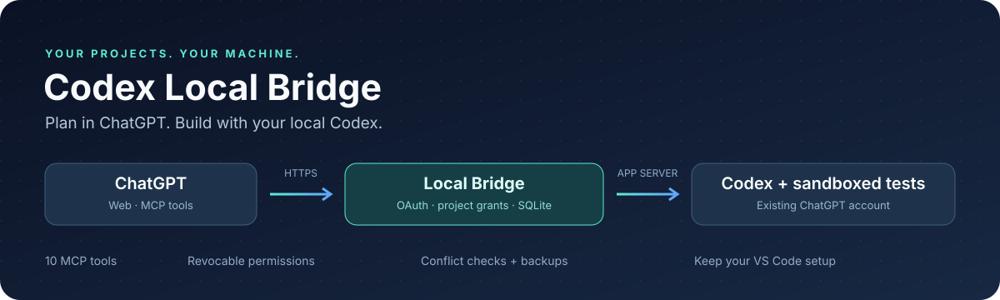
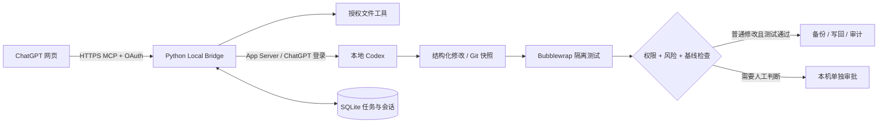

<div align="center">



# Codex Local Bridge

**在 ChatGPT 网页端规划，在自己的 Ubuntu 上让 Codex 修改、测试并交付代码。**

[](docs/VALIDATION.md)
[](https://github.com/yiwancibeishang123/codex-local-bridge/releases)
[](pyproject.toml)
[](LICENSE)

[快速开始](#快速开始) · [使用效果](#使用效果) · [项目授权](#项目授权一次明确同意随时撤销) · [工具列表](#十个-mcp-工具) · [故障排查](docs/TROUBLESHOOTING.md) · [English](docs/README_EN.md)

</div>

---

> **v0.5 Native Alpha（开发中）**：全新 PySide6 原生窗口，不再依赖浏览器使用 Studio；同一个工作台中可查看项目、选择关闭/只读/读写权限，提交 Codex 任务，浏览文件及管理项目级 SQLite 长期记忆。首次安装桌面依赖：`.venv/bin/python -m pip install -e '.[desktop]'`，之后从 Ubuntu 应用菜单点击即可。**只在开发分支，尚未升级正在运行的 MCP**。详见 [原生桌面版](docs/V05_NATIVE_ALPHA.md)。

> **新版：Ubuntu 桌面一键启动**：首次执行一次 `python3 scripts/studio_desktop.py install`，以后从 Ubuntu 应用菜单点击 **Bridge Studio** 即可启动本地控制台并打开浏览器。可固定在 Dock，自动检测/启动服务，不需要每天输入一堆命令。[桌面安装说明](docs/V04_ONE_CLICK_DESKTOP.md)。

> **Bridge Studio v0.4 Beta（开发分支）**：现已提供本地中文管理 UI、项目级 SQLite 记忆、手动保存任务验收结果、记忆交接与测试状态详情。测试地址 `http://127.0.0.1:8768`（**仅 Ubuntu 本机**）。[查看 Beta 安装与限制](docs/V04_BETA_RELEASE.md) · [UI 使用说明](docs/STUDIO_V04_QUICKSTART.md) · [记忆交接协议](docs/V04_HANDOFF_GUIDE.md)。**未自动部署到现有 MCP；稳定版仍在 main。**

## 它解决什么问题

你在 ChatGPT 里讨论代码，但文件、测试环境和 VS Code 都在本机。Bridge 将两端接起来：网页端可以读取授权文件、委派编码任务、拿回真实测试结果，再继续同一个 Codex 会话。

| 你想做的事 | Bridge 的行为 |
|---|---|
| “先看看这个项目” | 只读取白名单内的 UTF-8 文件，返回正文、相对路径和 SHA-256 |
| “修复这个函数并运行测试” | Codex 返回结构化修改，Bridge 在独立快照运行本机配置的测试 |
| “以后普通修改不用每次敲 APPROVE” | 本机一次项目授权，普通代码修改可自动执行与写回；随时撤销 |
| “不要碰其他项目和凭证” | 项目白名单、路径检查、链接拒绝、敏感文件保护；危险修改独立审批 |
| “接着上一轮继续改” | 保存 thread_id、结果、Diff、日志和审计，继续同一会话 |
| “让插件自己维护自己” | 建立独立维护副本，普通修改可授权；正式服务部署仍单独审核 |

已有 VS Code Codex 插件可以继续使用。Bridge 使用独立 `CODEX_HOME`，不会接管 IDE 对话。

## 费用与平台权限：先确认这两件事

1. **Codex 执行权限**：使用已有 ChatGPT 账号登录官方 Codex App Server，不用按 Token 计费的 API Key。仍受套餐额度限制；额度不足会真实报错，不会自动购买额度或切到付费 API。[官方说明](https://help.openai.com/en/articles/11369540-using-codex-with-your-chatgpt-plan)
2. **ChatGPT 网页 MCP 权限**：Codex 订阅权限与“网页能否连接自定义 MCP、调用写工具”是两回事。维护者环境已经跑通，不代表任意 Plus 账号都有同样入口。**发布时官方将完整自定义 MCP 支持列在 Business、Enterprise/Edu 范围内**；请先查看自己账号/工作区的实际权限和[最新官方文档](https://help.openai.com/en/articles/12584461-connecting-custom-mcp-servers-in-chatgpt)。本项目无法解锁平台权限，也不会默认要求你付费升级。

本项目不需要云服务器或付费第三方中转。HTTPS 优先使用 [Tailscale Funnel](https://tailscale.com/docs/features/tailscale-funnel)，免费个人方案的资格、地区与使用限制以 [Tailscale 当前政策](https://tailscale.com/pricing) 为准。若账号不能使用远程 MCP，可先运行本机 stdio；这不能替代网页端连接。

## 工作方式



模型的原生 Shell、直接主机文件写入、联网工具和提权请求被禁用。测试由 Bridge 使用固定 argv 执行，快照只读、网络隔离。文件工具直接修改文本，不会自行运行测试。

## 快速开始

### 1. 安装到一个固定目录

已实测 Ubuntu 22.04 / Python 3.10。需要 Git、Python venv、bubblewrap，以及可正常登录的官方 Codex CLI。

```bash
sudo apt update
sudo apt install python3-venv git bubblewrap

git clone https://github.com/yiwancibeishang123/codex-local-bridge.git
cd codex-local-bridge

# 可选：安装已验证的官方 CLI 0.162.1 到用户私有目录，不需要 npm/root。
# 若已有兼容 CLI，可跳过；安装器也会探测 VS Code 扩展内的 Codex。
python3 scripts/install-engine.py
bash scripts/install.sh

~/.local/bin/codex-local-bridge login
~/.local/bin/codex-local-bridge doctor
systemctl --user enable --now codex-local-bridge
```

安装脚本创建 `.venv`、运行默认回归、生成私有配置和 systemd 用户服务，并初始化独立 `demo`。不会自动开公网入口、复制 IDE 凭证或提升项目写权限。已有配置和 unit 会保留；已有 unit 指向其他安装目录时，应先核对 `systemctl --user cat codex-local-bridge`，避免启动旧源码。

配置在 `~/.config/codex-local-bridge/config.json`，状态在 `~/.local/share/codex-local-bridge/`。配置权限必须为 `600`。**源码目录需保留在安装位置。**

### 2. 建立 HTTPS 入口

先安装并登录 Tailscale，完成其要求的 HTTPS/Funnel 权限设置。不要覆盖设备上已有的其他映射。

```bash
sudo tailscale login --qr --timeout=60s
sudo tailscale set --operator="$USER"
tailscale funnel status
tailscale funnel --bg 8767
```

将 Funnel 输出的实际 HTTPS origin 写入配置 `public_url`，然后：

```bash
systemctl --user restart codex-local-bridge
```

snap 版 CLI 自带 socket 参数，**不要重复加 `--socket`**。没有弹出浏览器时，打开终端给出的登录链接。HTTPS/Funnel 设置详见[官方文档](https://tailscale.com/docs/features/tailscale-funnel)。

### 3. 在 ChatGPT 添加 MCP 连接

在当前账号提供的自定义 MCP/插件入口，填写：

| 项目 | 值 |
|---|---|
| 服务地址 | `https://你的设备.你的尾网.ts.net/mcp` |
| 认证 | OAuth，支持动态客户端注册 |
| Scope | `bridge` |
| 默认回调 | `https://chatgpt.com/connector_platform_oauth_redirect` |

回调必须与连接界面给出的地址完全一致；不同则在本机调整 `redirect_uris` 后重启，不能允许任意回调。

授权页会显示一条含**真实请求 ID**的命令。在 Ubuntu 执行该命令并输入 `AUTHORIZE`，再刷新授权页面：

```bash
~/.local/bin/codex-local-bridge auth-requests
~/.local/bin/codex-local-bridge approve-auth 页面显示的真实请求ID
```

成功后应发现 **10 个工具**。新开聊天、选择该连接，再请求：“列出授权项目，读取 demo 的 calculator.py，暂不修改文件。”

直接在浏览器打开 `/mcp` 得到 `401 Authentication required` 是正常现象；MCP 客户端会携带 OAuth token。服务升级后需要刷新/重新发现工具；旧对话可能保留旧 Schema。平台自身也可能对工具操作弹出确认，本机项目授权不会覆盖这些平台规则。

## 项目授权：一次明确同意，随时撤销

默认 demo 只读。需要自动修改时，只对你选择的项目在本机配置以下权限：

```json
{
  "id": "demo",
  "name": "Python acceptance demo",
  "root": "/home/YOUR_USER/codex-bridge-demo",
  "include": ["*.py", "*.md"],
  "allowed_modes": ["read", "write_test"],
  "file_write_enabled": true,
  "project_authorization": true,
  "tests": [["/usr/bin/python3", "-m", "unittest", "discover", "-v"]]
}
```

默认 systemd 仅允许状态目录写入。若项目位于其他目录，还需给该项目添加精确可写路径：

```bash
mkdir -p ~/.config/systemd/user/codex-local-bridge.service.d
~/.local/bin/codex-local-bridge project-systemd demo \
  > ~/.config/systemd/user/codex-local-bridge.service.d/demo.conf
systemctl --user daemon-reload
systemctl --user restart codex-local-bridge

~/.local/bin/codex-local-bridge grant-project demo
# 核对范围，在交互终端输入 AUTHORIZE demo
~/.local/bin/codex-local-bridge project-policy demo
```

省略有效期表示持续有效；可以用 `grant-project demo --hours 24` 限时授权。撤销不需要重启：

```bash
~/.local/bin/codex-local-bridge revoke-project demo
```

| 范围 | 行为 |
|---|---|
| 无项目写授权 | 原文件保持只读；只读配置拒绝写工具，可写提案则等待本机单次审批 |
| 有效授权下的普通文件 | 自动创建、修改，保留 SHA/基线冲突检查、备份与审计 |
| Codex 普通任务 | 执行受限测试；至少一条配置测试且全部通过才自动写回 |
| 危险脚本、依赖/安全配置、疑似凭证内容 | 仍需独立审批，或由敏感路径规则直接拒绝 |
| 越权、隐藏凭证、软/硬链接 | 拒绝 |

源码后缀和风险分类是保守规则，不是完整 DLP。自动测试仅放行配置中的安全 `unittest` argv；其他测试框架暂时保留单次审批。完整规则、撤销边界与恢复办法见[项目授权说明](docs/PROJECT_AUTHORIZATION.md)。

## 使用效果

以下流程来自独立验收项目的真实执行记录，展示值已去掉账号、域名、任务 ID 和私有项目内容；不是截图，也不是模拟网页成功。

### 示例 A：修复 → 测试 → 继续同一会话

在已授权的 demo 中向 ChatGPT 发出：

> 修复 calculator.py 的 add(a, b)，让它返回 a + b。保留原测试，使用 write_test，并返回实际测试结果和是否写回。

随后：

> 继续上一个任务，保留 add 修复，增加 multiply(a, b) 和 multiply(3, 4) == 12 的单元测试。

观察到的结果：

| 回合 | 修改 | 真实测试 | 写回 |
|---|---|---|---|
| 第一轮 | `a - b` → `a + b` | 1 test，exit 0 | `changes_applied=true` |
| 第二轮，同一 thread | 新增 `multiply` 和单测 | 2 tests，exit 0 | `changes_applied=true` |
| 无编辑验收 | `edits=[]`、`diff=""` | 测试通过 | **`changes_applied=false`，不产生空备份** |

### 示例 B：读取 → SHA 精确编辑

文件工具返回平铺对象，同时提供 JSON 文本和 `structuredContent`：

```json
{
  "project_id": "demo",
  "path": "calculator.py",
  "sha256": "e1a894022d1a082987b87adecb623438c9e386d86b2b621cff4a5fe7fdf7edc8",
  "bytes": 32,
  "content": "def add(a, b):\n    return a - b\n",
  "redacted": false
}
```

此 SHA 对应示例中的原文件字节，不是修复后的内容。修改前先读取最新 SHA；`request_edit_file` 只替换唯一匹配片段。旧 SHA 会被拒绝，不能覆盖你在 VS Code 中刚做的修改。新文件使用 `expected_sha256="ABSENT"`。

**判断完成状态要看四个字段：**

| 字段 | 含义 |
|---|---|
| `state=succeeded` / `execution_succeeded` | 引擎返回了有效结果，不等于测试通过或已写回 |
| `tests_passed` | 由实际测试退出码决定；没有测试时为 null |
| `changes_applied` | 原项目文件是否真的写回；空差异必须为 false |
| `source_commit_created` | 当前不会自动提交源仓库；`snapshot_commit` 是隔离副本提交 |

更多真实验证范围、未覆盖项目和复现命令见[验收报告](docs/VALIDATION.md)。

## 十个 MCP 工具

| 工具 | 用途 |
|---|---|
| `list_projects` | 列出本机配置项目、文件范围、有效授权与测试 argv |
| `list_project_files` | 分层列出白名单内文件和目录，最多 200 项 |
| `read_project_file` | 读取 UTF-8、相对路径、SHA-256；单文件最多 128 KiB |
| `request_write_file` | 创建/整体替换；有效授权下普通文件自动应用 |
| `request_edit_file` | 基于最新 SHA 替换一个精确匹配片段 |
| `get_write_status` | 查询文件提案状态 |
| `delegate_task` | 异步提交 `read` / `write_test` 任务 |
| `get_task_status` | 查询排队、运行、测试和应用状态 |
| `get_task_result` | 返回真实 Diff、测试输出、分页日志和审阅摘要 |
| `continue_task` | 新任务 ID，续接已结束任务的 Codex thread |

授权、审批、撤销、精确 Diff 应用和部署命令**只在本机**提供，不暴露为网络工具。

## 用网页维护 Bridge 自身

```bash
~/.local/bin/codex-local-bridge register-maintenance
systemctl --user restart codex-local-bridge
~/.local/bin/codex-local-bridge grant-project bridge_maintenance
```

之后以 `project_id=bridge_maintenance` 委派。维护项目是独立 Git 源码副本，普通授权修改不会直接覆盖运行服务。其默认测试是语法/清单烟测，**不等于完整 pytest**；正式部署前必须审查 Diff、备份、跑全量回归，再单独发布与重启。

## 测试、升级与贡献

```bash
python3 -m venv .venv
.venv/bin/python -m pip install -e '.[test]'
.venv/bin/python -m pytest -q

# 可选：需本机已有 Bridge 配置和 ChatGPT Codex 登录；使用现有订阅额度。
BRIDGE_LIVE_CODEX=1 .venv/bin/python -m pytest tests/test_live_codex.py -q -s
```

提供[可启用的 GitHub Actions 模板](docs/ci/README.md)，默认不持有凭证，也不调用付费 API。当前发布凭证没有 workflow scope，因此云端 CI 尚未启用；上方测试徽章记录本地真实测试成绩。部分测试使用明确标注的确定性协议 fixture；这类通过结果不能冒充真实模型或 ChatGPT 浏览器端到端成功。

升级前查看 [CHANGELOG](CHANGELOG.md)，备份配置和状态目录，再按[贡献与发布约定](CONTRIBUTING.md)进行。GitHub 源码更新不会自动替你部署本机服务；不要对已运行的服务目录盲目 `git pull` 后直接重启。

<details>
<summary><strong>常见问题速查</strong></summary>

- **只看到 5 个工具 / 文件返回 `{}`**：确认服务已升级，重新扫描工具并启动新对话。新版五个文件工具有显式 outputSchema 和 structuredContent。运行 `scripts/check-connection.py` 检查实际 HTTPS 返回。
- **`awaiting_approval`**：核对项目本机开关、有效 grant、测试 argv 和风险类型；OAuth 同意不代表项目自动写权限。
- **测试通过但未写回**：检查 `changes_applied`、`apply_error`；空差异、风险修改、撤销、SHA 冲突或 systemd 只读都可能阻止写回。
- **Codex 额度不足**：等待当前套餐额度恢复；Bridge 不购买额度，也不会切换 API Key。
- **bwrap 失败**：运行 doctor，检查主机的用户命名空间策略；不要跳过沙箱。
- **服务重启后中断**：保留任务与 thread，显式重试/续接；不静默重放写入。

完整排查见 [TROUBLESHOOTING](docs/TROUBLESHOOTING.md)。

</details>

## 文档与许可

[权限策略](docs/PROJECT_AUTHORIZATION.md) · [安全边界](docs/SECURITY.md) · [真实验收](docs/VALIDATION.md) · [贡献指南](CONTRIBUTING.md) · [更新记录](CHANGELOG.md)

MIT License。独立社区项目，与 OpenAI、ChatGPT 或 Tailscale 无官方隶属关系。官方 Codex CLI 与 MCP SDK 通过原渠道安装，遵循各自许可证；本仓库不捆绑其二进制或任何登录凭证。
